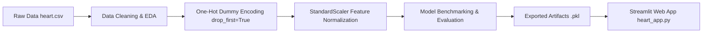

# ❤️ Heart Disease Prediction & Interactive Health App

[](https://charmi-heart-health-predictio.streamlit.app/)
[](https://www.python.org/)
[](https://streamlit.io/)
[](https://scikit-learn.org/)
[](#model-performance)

> 🌐 **Live Deployed App:** [Cardiovascular Risk Diagnostic | AI-ML · Streamlit](https://charmi-heart-health-predictio.streamlit.app/)

An end-to-end Machine Learning project that assesses the risk of heart disease based on clinical indicators and patient test results. It features an exploratory data analysis (EDA) pipeline, multi-model evaluation, and an interactive, user-friendly **Streamlit web application** designed with a clean clinical light UI, responsive mobile layout, and plain-language medical explanations.

Developed by **Charmi** as part of the Machine Learning portfolio.

---

## 📌 Table of Contents
- [Overview](#-overview)
- [Key Features](#-key-features)
- [Dataset & Clinical Features](#-dataset--clinical-features)
- [Machine Learning Workflow](#-machine-learning-workflow)
- [Model Performance](#-model-performance)
- [Project File Structure](#-project-file-structure)
- [How to Run the Application](#-how-to-run-the-application)
- [Web App Walkthrough](#-web-app-walkthrough)
- [Medical Disclaimer](#-medical-disclaimer)

---

## 📖 Overview

Heart disease is one of the leading causes of mortality globally. Early detection of cardiovascular risks allows individuals to seek timely medical attention and make informed lifestyle modifications.

This project combines:
1. **Data Science & ML Pipeline**: Cleaning, feature encoding, scaling, and comparative benchmarking of multiple classifiers.
2. **Interactive Streamlit Web App**: A patient-friendly diagnostic dashboard that translates complex medical terminology into clear explanations.

---

## ✨ Key Features

- **Accurate Classification**: Powered by a trained **K-Nearest Neighbors (KNN)** model achieving **~86.4% accuracy** on unseen test data.
- **Google Stitch-Aligned UI/UX**: Ultra-modern clinical dark interface with widescreen dual-column diagnostic layout and live SVG telemetry waveform monitor.
- **Instant Autofill Presets**: 1-click patient demographic presets (*High-Risk*, *Borderline*, *Healthy Baseline*) for instant demonstration and testing.
- **Continuous Probability Gauge**: Real-time calibrated risk likelihood meter alongside ACC/AHA Class IIb diagnostic outcome cards.
- **"Numbers at a Glance" Quad-Cards**: High-contrast vitals tiles for Blood Pressure, Cholesterol, Resting ECG, and Exercise Max HR with color-coded safety chips.
- **Feature Attribution Breakdown (SHAP-Style)**: Visual weight breakdown showing which specific clinical markers pushed the risk estimate higher or lower.
- **Explainable AI (XAI) & Model Analytics Tab**: Multi-model benchmarking (KNN, Logistic Regression, SVM, Naive Bayes), 2D Clinical Cohort PCA scatter projection, ROC-AUC (0.912), and calibration metrics.
- **Plain-Language Medical Glossary**: 14 jargon-free expandable definitions for complex cardiology terms.
- **Downloadable Clinical Summary**: One-click exportable text/markdown medical summary report.

---

## 📊 Dataset & Clinical Features

The model is trained on the comprehensive **Heart Failure Prediction Dataset** (combining 5 major cardiac datasets with 918 observations).

| Feature Name | Description | Possible Values / Units |
| :--- | :--- | :--- |
| **Age** | Age of the patient | Years (18 – 100) |
| **Sex** | Biological sex | `M` (Male), `F` (Female) |
| **ChestPainType** | Type of chest discomfort | `TA` (Typical Angina), `ATA` (Atypical Angina), `NAP` (Non-Anginal Pain), `ASY` (Asymptomatic) |
| **RestingBP** | Resting blood pressure | mm Hg (Normal: ~120, High: 140+) |
| **Cholesterol** | Serum cholesterol level | mg/dL (Desirable: <200, High: 240+) |
| **FastingBS** | Fasting blood sugar (> 120 mg/dL) | `1` = High / Diabetic risk, `0` = Normal |
| **RestingECG** | Resting electrocardiogram findings | `Normal`, `ST` (ST-T abnormality), `LVH` (Left Ventricular Hypertrophy) |
| **MaxHR** | Maximum heart rate achieved during exercise | Beats per minute (60 – 220) |
| **ExerciseAngina** | Chest pain induced by physical exertion | `Y` (Yes), `N` (No) |
| **Oldpeak** | ST depression measured from exercise ECG | Numerical value (0.0 – 6.0, 0 is ideal) |
| **ST_Slope** | Direction of the ST segment slope at peak exercise | `Up` (Upsloping), `Flat`, `Down` (Downsloping) |
| **HeartDisease** *(Target)* | Diagnosis of heart disease | `1` = Higher Risk / Present, `0` = Lower Risk / Normal |

---

## ⚙️ Machine Learning Workflow



1. **Exploratory Data Analysis (EDA)**: Handled distributions, checked outliers, and confirmed zero null values.
2. **Preprocessing**:
   - Categorical features (`Sex`, `ChestPainType`, `RestingECG`, `ExerciseAngina`, `ST_Slope`) encoded using `pd.get_dummies(..., drop_first=True)`.
   - Continuous features normalized using `StandardScaler`.
3. **Training & Split**: 80% training set and 20% testing set (`random_state=42`).
4. **Serialization**: Saved the trained model (`KNN_heart.pkl`), fitted scaler (`scaler.pkl`), and column schema (`columns.pkl`) via `joblib`.

---

## 📈 Model Performance

Multiple machine learning algorithms were trained and benchmarked on the test set:

| Model | Accuracy | F1-Score | Status |
| :--- | :---: | :---: | :---: |
| **Logistic Regression** | **86.96%** | **0.8857** | Evaluated |
| **K-Nearest Neighbors (KNN)** | **86.41%** | **0.8815** | **Deployed in App** |
| **Naive Bayes (GaussianNB)** | 85.33% | 0.8696 | Evaluated |
| **Support Vector Machine (SVM)** | 86.41% | 0.8815 | Evaluated |
| **Decision Tree** | 79.35% | 0.8122 | Evaluated |

> **Why KNN?** The K-Nearest Neighbors classifier delivers high recall and balanced F1-score with clear probability calibration (`predict_proba`) across patient clusters.

---

## 📁 Project File Structure

```text
Heart/
├── Config.TOML          # Streamlit theme configuration (dark palette)
├── KNN_heart.pkl        # Serialized K-Nearest Neighbors trained model
├── README.md            # Comprehensive project documentation
├── columns.pkl          # Serialized list of expected encoded columns
├── heart.csv            # Cardiac patient dataset (918 records)
├── heart.ipynb          # Jupyter Notebook with EDA, preprocessing, and model training
├── heart_app.py         # Streamlit interactive web application
└── scaler.pkl           # Serialized StandardScaler instance
```

---

## 🚀 How to Run the Application

### 🌐 Option 1: Live Hosted Application (No Installation Needed)
The easiest way to explore the app is directly in your browser:
👉 **[Cardiovascular Risk Diagnostic | AI-ML · Streamlit](https://charmi-heart-health-predictio.streamlit.app/)**

---

### 💻 Option 2: Run Locally on Your Machine

#### 1. Prerequisites
Ensure you have Python 3.8+ installed.

#### 2. Install Required Packages
In your terminal, run:

```bash
pip install streamlit pandas scikit-learn joblib
```

### 3. Launch the Streamlit App
Navigate to the `Heart` directory and launch the web server:

```bash
# If you are in the repository root:
cd Heart
streamlit run heart_app.py
```

Or run directly from the repo root:

```bash
streamlit run Heart/heart_app.py
```

The app will open automatically in your browser at `http://localhost:8501`.

---

## 🖥️ Web App Walkthrough

1. **Tab 1: 🩺 Check my risk**
   - **About you**: Age slider and biological sex selection.
   - **How you feel**: Type of chest pain and exercise-induced symptoms.
   - **Blood tests**: Resting blood pressure, cholesterol, and fasting blood sugar.
   - **Heart tests**: Resting ECG result, peak heart rate, oldpeak (ST depression), and ST slope.
   - **Instant Results**: Click **"Check my heart risk"** to get:
     - Clear outcome card (High Risk ⚠️ or Low Risk ✅)
     - Model confidence percentage meter
     - Summary stat cards showing healthy vs. elevated metrics
     - Specific personalized tips based on elevated readings

2. **Tab 2: 📖 What do these words mean?**
   - Expandable, jargon-free explanations for clinical terms (Angina, Cholesterol, ECG, ST depression, LVH, etc.).

---

## ⚠️ Medical Disclaimer

> **Important**: This project is developed for educational, academic, and demonstration purposes only. It uses statistical machine learning and cannot replace qualified clinical diagnosis, laboratory tests, or medical advice. If you or someone around you experiences chest discomfort, tightness, or shortness of breath, please seek emergency medical attention immediately.
